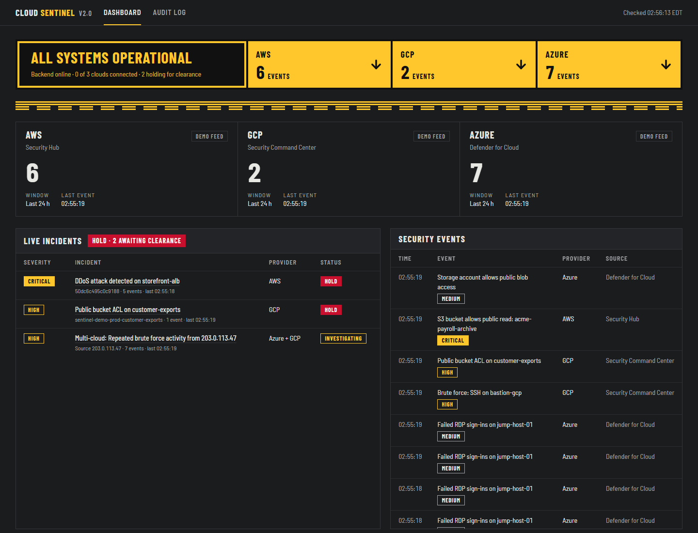
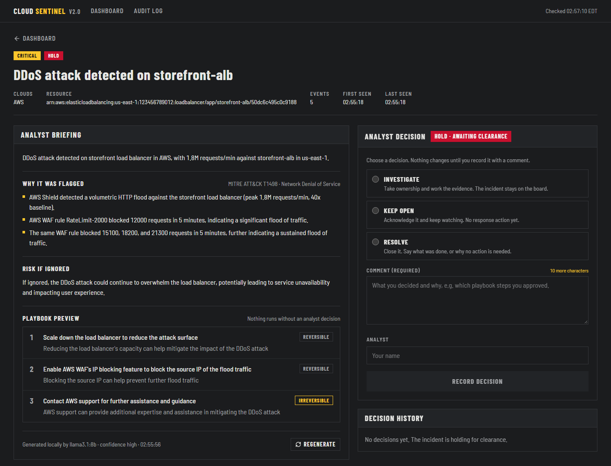
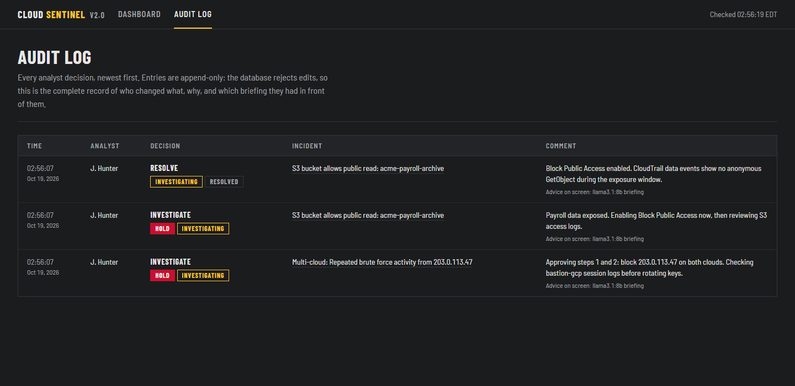
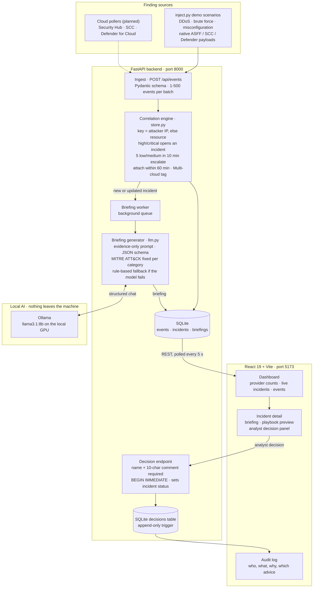
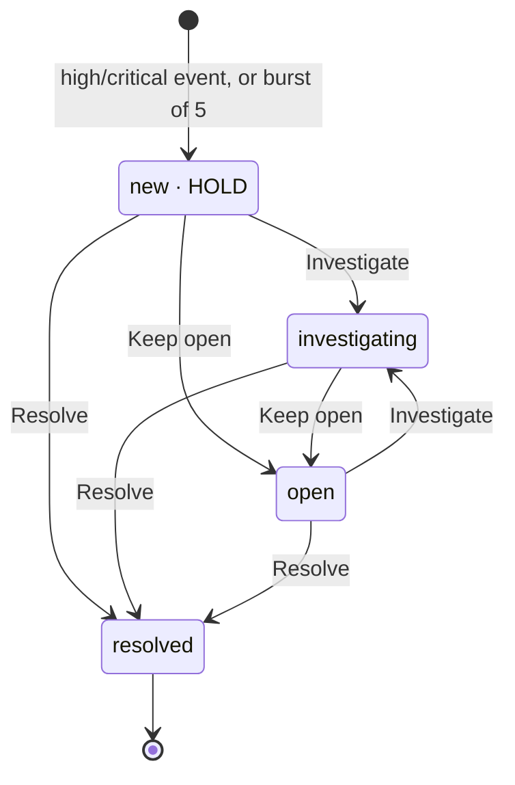

<div align="center">

# Cloud Sentinel 

### Zero-cost multi-cloud SOC dashboard with local-LLM triage and human-in-the-loop response


-000000?logo=ollama&logoColor=white)

**AWS Security Hub · GCP Security Command Center · Microsoft Defender for Cloud: one board, one hold line, one audit trail.**

[Overview](#overview) • [Screenshots](#screenshots) • [Architecture](#architecture) • [How it works](#how-it-works) • [Security design](#security-design) • [Quick start](#quick-start) • [API](#api) • [Roadmap](#roadmap)

</div>

---

## Overview

A SOC analyst covering three clouds has to watch three consoles, each with its own alert format, and gets no help connecting an attacker who moves between them. AI assistants can help with triage, but most send your findings to a third-party API and blur who actually decided what.

Cloud Sentinel is a mini-SIEM that handles all of this on one laptop at zero cost:

- **One schema for three clouds.** Findings from AWS Security Hub (ASFF), GCP Security Command Center and Microsoft Defender for Cloud are normalized into a single event model.
- **Correlation, including across clouds.** Events group into incidents by attacker IP or resource. When the same IP shows up in a second cloud, the incident is flagged **Multi-cloud**.
- **Local AI briefings.** A local `llama3.1:8b` model running in Ollama explains *why* each incident was flagged and previews a response playbook. **No finding leaves the machine.**
- **Human-in-the-loop by design.** Every incident starts on **HOLD**. Only an analyst decision with a written justification can change its status, and the system never executes a playbook step.
- **Tamper-resistant audit trail.** Decisions go to an append-only SQLite table that rejects edits. Each one records which AI or rule-based advice was on screen, so AI advice and human judgment can be compared afterwards.

---

## Screenshots

**Dashboard.** Per-provider event counts, live incidents holding for clearance, and the normalized event stream.



**Incident detail.** The local-LLM briefing with a deterministic MITRE ATT&CK mapping, the playbook preview marked reversible or irreversible, and the analyst decision panel.



**Audit log.** Who decided what, the status before and after, the justification, and which advice was on screen.



---

## Architecture



| Component | File | Responsibility |
|-----------|------|----------------|
| **API** | `backend/main.py` | FastAPI routes, CORS limited to the local frontend, startup (DB init, model warm-up, briefing worker) |
| **Schema** | `backend/schemas.py` | Pydantic models for events, incidents, decisions and briefings. Strict enums for provider, severity, category and status |
| **Correlation and storage** | `backend/store.py` | SQLite persistence, event-to-incident correlation, decision transactions, append-only audit table |
| **LLM briefings** | `backend/llm.py` | Prompt construction, Ollama call with a JSON schema, validation, retry, rule-based fallback |
| **Briefing worker** | `backend/briefing_worker.py` | Pre-generates briefings in the background so they're ready when an analyst opens the incident |
| **Demo injector** | `backend/inject.py` | Pushes realistic attack scenarios with native-format payloads (ASFF, SCC, Defender) |
| **Frontend** | `frontend/src/` | Dashboard, incident detail, decision panel and audit log. Fully offline, with no CDNs or remote fonts |

---

## How it works

### 1. Ingestion and normalization

Every finding becomes an `EventIn` (`backend/schemas.py`) with a provider (`aws` / `gcp` / `azure`), native source, category (`ddos`, `brute_force`, `misconfiguration`, `malware`, `anomalous_access`, `other`), severity, resource, region, actor IP, native finding ID, and the **original provider payload** kept in `raw` for evidence.

### 2. Correlation (`backend/store.py`)

| Rule | Behaviour |
|------|-----------|
| Correlation key | `ip:<attacker IP>` when one is present, otherwise `resource:<resource>`. The same attacker IP across clouds is the strongest multi-cloud signal |
| High or critical event | Opens an incident immediately with status `new` (shown as **HOLD**) |
| Low or medium events | Escalate only when **5** with the same category and key arrive within **10 minutes** |
| Follow-on events | Attach to a matching open incident seen in the last **60 minutes**. Severity rises to the highest seen |
| Second cloud | When an attached event comes from another provider, the incident is retitled **Multi-cloud** |

### 3. AI briefing with guardrails (`backend/llm.py`)

When an incident is created or gains events, a background worker asks the local model for a briefing: a **summary**, **why it was flagged** (2–5 evidence-based reasons), **risk if ignored**, a **3–6 step playbook** with each step marked reversible or irreversible, and a **confidence** level.

- **Grounded:** the prompt contains only the incident's evidence (up to 10 events, raw payloads trimmed), and the model is told never to invent IPs, resources, counts or times.
- **Structured:** Ollama is called with the Pydantic JSON schema as the required output format, and the reply is validated. Invalid JSON gets one retry.
- **Deterministic where it matters:** the MITRE ATT&CK technique comes from a fixed category map (for example `brute_force` → T1110, `ddos` → T1498, `misconfiguration` → T1530), so the model can't misattribute it.
- **Always available:** if Ollama is offline or the output fails validation, a rule-based briefing is shown instead and labelled as such.
- **Never executed:** the playbook is a preview. Approved steps are recorded in the analyst's comment, and the system runs none of them.

### 4. Human oversight and the incident lifecycle



- Only an analyst decision changes status (`POST /api/incidents/{id}/decisions`).
- Every decision needs an **analyst name** (2–80 chars) and a **comment of at least 10 characters**. Whitespace is stripped first, so padding doesn't count.
- Re-applying the current status is rejected with `409`. A resolved incident is closed for good, and new activity from the same source opens a new incident.
- Each decision is written in a `BEGIN IMMEDIATE` transaction, so two analysts can't race on the same incident.

### 5. Audit trail

The `decisions` table is append-only: a SQLite trigger aborts any `UPDATE`. Each row records the analyst, action, justification, the **status before and after**, and **which briefing was on screen** (LLM model and time, or rule-based). That makes it possible to review afterwards where analysts followed or overrode the AI's advice.

---

## Security design

| Concern | How it's handled |
|---------|------------------|
| **Data leaving the environment** | All AI inference runs locally through Ollama. No cloud LLM API and no telemetry |
| **AI overreach** | The model only advises. Status changes need a human decision, and playbook steps are never executed automatically |
| **Hallucinated evidence** | Evidence-only prompt, a JSON schema enforced at generation and validated after, a fixed ATT&CK mapping, and a labelled rule-based fallback |
| **Audit tampering** | An append-only `decisions` table enforced by a database trigger, with before and after status recorded per decision |
| **Race conditions** | Decisions take the write lock up front with `BEGIN IMMEDIATE` |
| **Input abuse** | Pydantic validation on every request: enums, length limits, and 1–500 events per ingest batch |
| **Cross-origin access** | CORS allows only the local frontend origins |
| **Secrets in git** | `.env*`, keys, `credentials*.json` and local databases are gitignored. Future cloud credentials belong in `.env` |
| **Demo data** | All IPs come from RFC 5737 documentation ranges, and account and project IDs are synthetic |

> **Scope note:** the API has no authentication and is meant to run on `localhost` only. Add authentication before exposing it on a network (see [Roadmap](#roadmap)).

---

## Quick start

### Prerequisites

- Python 3.13, Node.js 20+
- [Ollama](https://ollama.com) (optional; without it, rule-based briefings are used)
- A GPU helps: an RTX 4050 (6 GB) generates a briefing in about 10–15 s

### 1. Backend (FastAPI)

```powershell
# Windows (PowerShell)
py -3.13 -m venv backend\.venv
backend\.venv\Scripts\Activate.ps1
pip install -r backend\requirements.txt
cd backend
uvicorn main:app --reload --port 8000
```

```bash
# macOS / Linux
python3.13 -m venv backend/.venv && source backend/.venv/bin/activate
pip install -r backend/requirements.txt
cd backend && uvicorn main:app --reload --port 8000
```

### 2. Frontend (React + Vite)

```bash
cd frontend
npm install
npm run dev
```

Open **http://localhost:5173**. Vite proxies `/api/*` to the backend on port 8000. Interactive API docs are at **http://127.0.0.1:8000/docs**.

### 3. Local LLM (optional)

```powershell
winget install Ollama.Ollama   # once; Ollama then runs in the background
ollama pull llama3.1:8b        # once, ~4.9 GB
```

The backend warms the model up at startup. Before a demo, start the backend a minute early and open one incident to confirm the footer says **"Generated locally by llama3.1:8b"**.

| Variable | Default | Purpose |
|----------|---------|---------|
| `OLLAMA_URL` | `http://127.0.0.1:11434` | Ollama server |
| `OLLAMA_MODEL` | `llama3.1:8b` | Model (`mistral:7b` also works) |
| `OLLAMA_NUM_GPU` | `99` | Layers on the GPU. Forced high because Ollama's default leaves ~25% of the model on the CPU on a 6 GB GPU (3× slower). Lower it if you hit out-of-memory errors |
| `OLLAMA_NUM_CTX` | `3072` | Context window, which fits 10 events of evidence plus the answer |

### 4. Run a demo attack

With the backend running, push synthetic attack findings from a third terminal:

```bash
cd backend
python inject.py all          # or one scenario below
python inject.py all --delay 1   # slower, so the dashboard fills visibly
python inject.py reset        # clear everything before a presentation
```

| Scenario | What it simulates | Clouds | What you should see |
|----------|-------------------|--------|---------------------|
| `ddos` | Shield DDoS on a load balancer plus WAF rate-limit hits | AWS | A critical incident with follow-on WAF events attached |
| `brute-force` | RDP brute force on an Azure jump host, then the same IP on GCP SSH | Azure → GCP | A **Multi-cloud** incident correlated on `203.0.113.47` |
| `misconfig` | Public GCP bucket, public S3 bucket, Azure public blob access | GCP, AWS, Azure | Separate misconfiguration incidents (T1530) |

---

## API

| Method | Path | Purpose |
|--------|------|---------|
| GET | `/api/health` | Liveness |
| GET | `/api/summary` | Per-provider 24 h counts, incidents awaiting clearance |
| GET | `/api/events?limit=50` | Newest normalized events |
| POST | `/api/events` | Ingest `{channel, events: [...]}` (injection scripts, later cloud pollers) |
| GET | `/api/incidents?include_resolved=false` | Incidents, awaiting clearance first, then by severity |
| GET | `/api/incidents/{id}` | One incident with its events |
| GET | `/api/incidents/{id}/briefing?refresh=false` | Briefing. `state` is `ready`, `updating` or `generating` (poll until `ready`) |
| GET | `/api/llm/status` | Whether Ollama is reachable and the model is installed |
| POST | `/api/incidents/{id}/decisions` | Analyst decision `{action: investigate \| keep_open \| resolve, comment, analyst}`. The only way status changes |
| GET | `/api/incidents/{id}/decisions` | Decision history for one incident |
| GET | `/api/audit` | Every decision, newest first |
| POST | `/api/admin/reset` | Clear all data (demo use) |

---

## Project structure

```
cloud-sentinel-soc/
├── backend/
│   ├── main.py              # FastAPI app and routes
│   ├── schemas.py           # Pydantic models: events, incidents, decisions
│   ├── store.py             # SQLite, correlation rules, append-only decisions
│   ├── llm.py               # Ollama briefings, guardrails, rule-based fallback
│   ├── briefing_worker.py   # Background briefing queue
│   ├── inject.py            # Demo attack scenarios (ASFF / SCC / Defender payloads)
│   └── requirements.txt
└── frontend/
    ├── src/
    │   ├── App.jsx          # Dashboard and routing
    │   ├── api.js           # API client and 5 s polling
    │   ├── decisions.js     # Analyst actions
    │   └── components/      # IncidentDetail, DecisionPanel, AuditLog, ProviderGrid, ...
    ├── DESIGN.md            # Visual system ("hold line" signage theme)
    └── PRODUCT.md           # Users, purpose and constraints
```

---

## Tech stack

- **Backend:** Python 3.13, FastAPI, Pydantic v2, SQLite (WAL mode), Uvicorn
- **AI:** Ollama running `llama3.1:8b` locally, with structured JSON output
- **Frontend:** React 19, Vite, Tailwind CSS 4, lucide-react, self-hosted Barlow fonts (works fully offline)
- **Data formats:** AWS Security Finding Format (ASFF), GCP SCC findings, Microsoft Defender for Cloud alerts

---

## Roadmap

- [ ] **Live cloud pollers:** pull findings from AWS Security Hub (Boto3), GCP Security Command Center and Microsoft Defender for Cloud with read-only, least-privilege credentials
- [ ] **API authentication** and analyst identity, instead of a free-text name
- [ ] **Automated tests** with pytest for the correlation rules, decision state machine and append-only trigger
- [ ] **Tamper-evident audit export:** hash-chained decision records
- [ ] **More detections** for `malware` and `anomalous_access`, with richer ATT&CK coverage
- [ ] **Metrics** on how often analysts agree with the AI briefing, from the recorded advice

---

<div align="center">

Built by [Yash Hirve](https://hirveyash.github.io/) · [LinkedIn](https://www.linkedin.com/in/yashhirve) · [GitHub](https://github.com/hirveyash)

</div>
